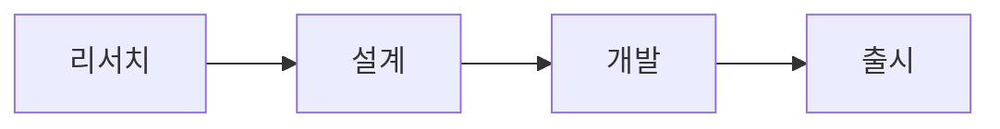

<!-- _class: lead -->

# 2026 상반기 제품 로드맵

발표 시작본 · 샘플 콘텐츠

---

# 신규 사용자 전환율 18% 개선

- **온보딩 4단계 → 3단계**: 가입 후 이탈이 많던 단계를 합쳤습니다.
- **체크리스트 완료율 +24%p**: 첫 주 안에 핵심 기능을 써 본 사용자가 늘었습니다.
- **무료 체험 → 유료 2.1배**: 체험 기간 중 안내 메일을 개선했습니다.

---

# 분기별 활성 사용자 (백만 명)

| 분기 | 활성 사용자 |
| --- | --- |
| Q1 | 1.2 |
| Q2 | **1.5** |

---

# 진행 단계

---

<!-- _class: lead -->

# 다음 분기 목표

- 온보딩 완료율 70% 달성
- 유료 전환 경로 A/B 테스트
- 분기 리뷰 자료 자동 생성

질문과 의견을 받습니다.
